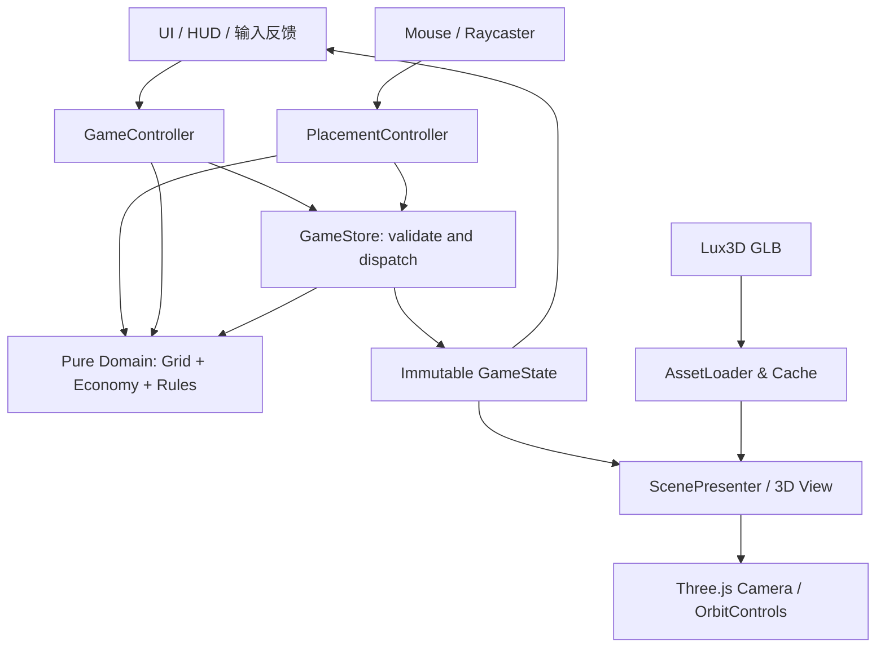

# 《最后一块地》技术架构与工程开发规范 v1.1

**修订日期** 2026-11-08 · **适用对象** Codex 主工程、Zcode UI 协作、Lux3D 资产生产 · **交付目标** 11 月 8 日 12:00 前可运行 Web Demo。

**规则依据：** docs/PRD.md v1.1；操作状态、污染预览、撤销和资产最低验收必须与该文档一致。

## 1. 技术决策记录 ADR-001

### 最终技术栈

| 模块 | 采用 | 原因 | 不采用 |
|---|---|---|---|
| 3D 浏览器渲染 | **Three.js** | 原生 GLTFLoader、OrbitControls、Raycaster；与 GLB 网页交付最直接 | 本次不转 Godot 或 Unity |
| 语言 | **TypeScript 严格模式** | 类型明确，适合 AI 协作及规则代码的维护 | 不采用无类型全局 JS |
| 工程 | **Vite** | 开发快、静态生产构建，容易部署 | 不加 SSR、大型 Web 框架 |
| UI | **原生 HTML + CSS** | 两侧 HUD 与结果弹窗足够，避免框架成本 | 不增加 React、Vue 状态层 |
| 3D 资产 | **Lux3D 输出 GLB** | 官方支持图/文生 3D 和 GLB 等产物 | 不运行时调用 Lux3D |
| 测试 | **Vitest + Node / Browser 手工冒烟测试** | 经济逻辑纯函数自动化；可单独测试 | 不引入重量级端到端框架作为 P0 |
| 部署 | **Vercel 或等效静态托管** | Vite 正式支持静态部署 | 不增加数据库、后端 |
| 版本管理 | **Git + npm lockfile** | 可复现和分阶段检查 | 不同时让多个智能体改同一批文件 |

**锁定原则：** 创建工程时使用兼容且当日可安装的正式发布版本，提交 `package-lock.json` 固定具体版本；使用 `npm ci` 验证。不要为了“最新最热”盲目追 beta。Three.js 与 Vite 在 2026 年仍有官方活跃文档和维护生态，符合本项目需要；并不意味着它们是所有 3D 游戏的最佳选择。

依据：Three.js 官方 GLTFLoader / OrbitControls [T1][T2]、Vite 官方构建与部署 [T3]、Lux3D 官方能力 [T4]。

## 2. 架构图与模块职责



### 模块职责边界

- `domain/types.ts`：只声明建筑类型、地图坐标、游戏状态、结算结果。
- `domain/grid.ts`：纯函数，判断格子边界、占地、重叠和最小距离。
- `domain/economy.ts`：纯函数，计算成本、利润、污染、满意度、分数。
- `domain/validation.ts`：纯函数，判定必选配置、二选一、可提交与成功。
- `state/gameStore.ts`：保存唯一游戏状态、提供可控 `dispatch(action)`；不直接访问 Three.js。
- `scene/SceneManager.ts`：创建/销毁 Three.js 场景、相机、灯光、网格与单一渲染循环。
- `scene/AssetLoader.ts`：异步加载、缓存、克隆 GLB；失败时使用占位几何体。
- `scene/PlacementController.ts`：Raycaster 点击命中、Hover 预览和坐标转换；将动作发给 store。
- `scene/ScenePresenter.ts`：观察状态，呈现模型与污染范围；不改写经济计算。
- `ui/HUD.ts`：建筑卡片、数值、错误提示、结果；仅接入 store 的读写接口。
- `data/gameConfig.ts`：建筑、预算、污染范围、评分和称号的唯一配置源；不再另设重复的 `data/buildings.ts`。
- `main.ts`：作为轻量组合入口承担图中的 GameController，连接 store、场景和 HUD，不再增加一套状态控制器。

**核心原则：** 3D 渲染只关心展示，经济学计算只关心网格数据。GLB 模型换了，经济规则不变；UI 换了，计算规则不变。避免十几层接口和复杂 ECS，当前 1 关没有必要。

## 3. 数据模型与规则接口

```ts
export type BuildingType = 'factory' | 'house' | 'park' | 'shop';
export type Cell = Readonly<{ x: number; y: number }>;

export interface BuildingInstance {
  readonly id: string;
  readonly type: BuildingType;
  readonly origin: Cell; // 左下角占地原点，格子坐标
}

export interface GameState {
  readonly gridSize: 5;
  readonly initialBudget: 80;
  readonly placed: readonly BuildingInstance[];
  readonly selectedType: BuildingType | null;
  readonly selectedBuildingId: string | null;
  readonly mode: 'place' | 'select' | 'move';
  readonly phase: 'intro' | 'playing' | 'result';
}

export interface Evaluation {
  readonly spending: number;
  readonly remainingBudget: number;
  readonly monthlyNet: number; // 经营期游戏指标；不代表真实月收益
  readonly averageSatisfaction: number | null; // 无住宅时为 null
  readonly score: number;
  readonly complete: boolean;
  readonly won: boolean;
  readonly errors: readonly string[];
}
```

**必须定义的纯函数：**

```ts
footprintCells(building: BuildingInstance): readonly Cell[]
canPlace(state: GameState, candidate: BuildingInstance): ValidationResult
pollutionCells(factory: BuildingInstance, gridSize: number): readonly Cell[]
minManhattanDistance(a: BuildingInstance, b: BuildingInstance): number
isHouseDownwindOfFactory(house: BuildingInstance, factory: BuildingInstance): boolean
evaluateCity(state: GameState): Evaluation
```

采用单向数据流：UI / 三维拾取产生操作 → store 校验动作 → 更新 `GameState` → 经济计算 → View / HUD 刷新。domain 不持有或修改 store；禁止 HUD 自己重算利润，或由模型坐标反推占地。

### 操作接口与状态约束

```ts
export type ValidationResult =
  | { readonly valid: true }
  | { readonly valid: false; readonly errors: readonly string[] };

export type GameAction =
  | { readonly type: 'START' }
  | { readonly type: 'SELECT_TYPE'; readonly buildingType: BuildingType | null }
  | { readonly type: 'SELECT_BUILDING'; readonly id: string | null }
  | { readonly type: 'BEGIN_MOVE'; readonly id: string }
  | { readonly type: 'PLACE'; readonly building: BuildingInstance }
  | { readonly type: 'MOVE'; readonly id: string; readonly origin: Cell }
  | { readonly type: 'DELETE'; readonly id: string }
  | { readonly type: 'CANCEL' }
  | { readonly type: 'UNDO' }
  | { readonly type: 'RESET' }
  | { readonly type: 'SUBMIT' }
  | { readonly type: 'CONTINUE' };
```

`gameStore` 提供 `getState()`、`subscribe(listener)` 和 `dispatch(action): ValidationResult`。无效操作通过返回值反馈错误，不修改布局、预算、交互状态或撤销快照；纯选中和预览可在有效操作下更新交互状态。

| 操作 | 校验与更新 | 撤销记录 |
|---|---|---|
| PLACE | 新 ID 唯一，类型合法，坐标为整数；上限工厂 1、住宅 2、设施合计 1；边界、占地、预算均合法再添加 | 成功时存变更前的 placed |
| MOVE | 必须存在同 ID 建筑，不改类型；canPlace 将候选视作替换同 ID，先排除旧实例再检查；预览不改 placed，合法落点再更新 | 有实际位置变化才存快照 |
| DELETE | 必须存在该 ID；删除后费用由剩余建筑重算，按原价全额退款 | 成功时存快照 |
| SELECT_TYPE | 已有设施时拒绝选择另一设施；合法时设置 selectedType、清空 selectedBuildingId；有类型则 mode=place，否则 mode=select | 不改快照 |
| SELECT_BUILDING | ID 必须存在或为 null；设置 selectedBuildingId、清空 selectedType，mode=select | 不改快照 |
| BEGIN_MOVE | ID 必须存在；设置 selectedBuildingId，清空 selectedType，mode=move；placed 不变 | 不改快照 |
| CANCEL | 退出移动/选中，selectedType/selectedBuildingId 清空，mode=select；保留建筑及预算 | 不改快照 |
| UNDO | 恢复最近一次成功变更前的 placed；清空两个选中字段，mode=select；只支持一步，无重做 | 恢复后清空 |
| RESET | placed 为空，selectedType/selectedBuildingId 为 null，mode=select，phase=playing；预算由空布局算回 80 | 清空，不可撤销重置 |
| SUBMIT / CONTINUE | 不完整提交拒绝；完整提交进入 result；继续调整回到 playing，保留 placed | 不改快照 |

快照仅保存 `readonly BuildingInstance[] | null`，由 store 私有持有；仅历史布局，不复制经济派生值。START 从 intro 进入 playing，初始无选中、mode=select、空布局、空快照；布局动作仅在 playing 接受，result 时先 CONTINUE 或 RESET。

`evaluateCity` 对无住宅返回 averageSatisfaction=null；一栋住宅计算该栋值，HUD 标出 1/2；未齐全或状态非法时 complete=false、won=false、score=0，不授称号。完整且合法时才按 PRD 判定分数和通关，结果须为有限数。`canPlace` 对同 ID 替换只服务 MOVE，store 必须拒绝借 PLACE 复用 ID 或借 MOVE 更改类型。

## 4. 3D 与空间坐标规范

- 本版固定 1 格 = 1 世界单位。逻辑 x 向东、y 向北；映射为 X=x、Z=-y，高度为 Y。网格中心偏移由同一个转换函数处理，不能在输入和渲染中各写一套；指北和西→东箭头跟随世界坐标，不固定为屏幕左右。
- 每栋建筑使用明确锚点 `origin` 和 `width × depth`；渲染模型放在占地中心，内部网格坐标是唯一真值。
- 相机只影响观察，不改变城市布局。
- 光照简化：Ambient / Hemisphere + 一盏 Directional，阴影可选；低配电脑不强行使用实时阴影。
- 放置/移动预览的 Raycaster 只检测 ground；建筑选择检测按逻辑占地生成的代理对象，代理携带 buildingId，不依赖 GLB 网格的复杂度。普通点击优先处理占地代理；点击空格且 selectedType 非空才新建；move 模式点击 ground 确认落点，校验排除自身。
- 左键短按放置/选择，左键拖动旋转，滚轮缩放；按下至抬起最大位移超过 5 CSS 像素则仅旋转，不派发布局动作。HUD 阻止事件穿透；Esc 或取消退出移动，指针坐标根据 canvas 实际边界换算。
- 城市网格使用原生 BoxGeometry / PlaneGeometry，不用 Lux3D 生成可交互地形网格。

## 5. Lux3D 资产规范

官方 Lux3D 平台：https://lux3d.aholo3d.cn/ 。官方说明支持文/图生成 3D、GLB、材质与预览能力 [T4][T5]。

**资产清单（按优先级）：**

| Asset ID | 模型 | 生成 | 游戏实例 | 游戏规则 |
|---|---|---|---|---|
| factory | 臭豆腐工厂 | 优先生成的真实 Lux3D GLB | 1 | 2×2 占地，按公式污染 |
| house | 微缩住宅 | 可选 Lux3D；缺失则几何体 | 复用为 2 栋 | 1×1，占地与满意度 |
| shop | 便利店 | 有时间则 Lux3D | 0/1 | 1×1，提高利润 |
| park | 公园 | 几何体 + 小型装饰 | 0/1 | 2×2，满意度加成 |

**最低验收：** 至少一个真实 Lux3D GLB 成功加载并用于可摆放的核心建筑，优先工厂；住宅、商店可用有明确提示的几何体。若唯一真实资产是住宅，须实际用于两栋住宅并如实记录。只有生成截图、未导入游戏或仅用于装饰不算通过。这是项目验收口径，官方仍要求 Lux3D 用于核心内容或关键创作流程。工厂优先，其次住宅，再考虑商店，不因第二/第三个 GLB 阻塞可玩闭环。

**推荐英文提示词：**

`A single stylized low-poly miniature tofu factory game asset, distinctive tall brick chimney, warm terracotta roof, cream walls, toy-like proportions, coherent 360-degree geometry, clean isolated object, no ground, no people, no words, no logos, cartoon style.`

`A single stylized low-poly miniature two-story house game asset, warm cream walls, terracotta roof, a few windows, coherent 360-degree geometry, clean isolated object, no ground, no people, no words, no logos, cartoon style.`

**校验与导入：**

1. 保存实际 Lux3D 模型生成截图、任务 ID（如有）、原始 GLB、生成参数。
2. 下载完整 GLB；**3DGS 预览不是可直接供 GLTFLoader 使用的网格替代物**。
3. 用独立 3D 查看器检查模型正面、侧面、背面、材质、贴图、破面。
4. 在 `AssetLoader` 中归一化模型包围盒并对齐底面，但**不要用模型实际尺寸改写建筑占地**。
5. 根据许可证与主办方规则记录模型生成平台和素材来源。
6. 加载失败或资产未提供时，使用符合逻辑占地的原生几何体；玩家可见「工厂/住宅：使用占位模型」等状态提示，同时记录控制台警告。不得只写日志或白屏。
7. 性能预算：每资产目标 GLB <15MB、贴图优先 ≤1K、首屏稳定 30 FPS；属于工程目标，必须实测，非平台保证。

### 文件位置与加载 URL

`public/models/factory.glb` 是源文件位置，根路径部署时浏览器 URL 为 `/models/factory.glb`，不得请求 `/public/models/factory.glb`。加载配置统一拼接 `import.meta.env.BASE_URL`：

```ts
const factoryUrl = `${import.meta.env.BASE_URL}models/factory.glb`;
const houseUrl = `${import.meta.env.BASE_URL}models/house.glb`;
```

只请求已提供的资产；缺失的可选资产直接进入占位状态。生产检查须确认请求返回成功且内容是有效 GLB，不能将托管平台返回的 index.html 或占位回退当成加载成功。分别验证根路径和非根 base；检查实际文件的压缩扩展，按需配置 Draco/KTX2/Meshopt 解码器，或采用经验证可直接加载的导出，不预先增加无用依赖。[T1][T9]

## 6. 代码、注释与可维护性标准

### 命名

- TypeScript 文件命名统一 `camelCase.ts`（如 `evaluateCity.ts`）或采用上文固定模块名；不得同一目录混用风格。
- 类型/接口 `PascalCase`，变量/函数 `camelCase`，常量 `UPPER_SNAKE_CASE`。
- 固定 `strict: true`、禁用 `any`（仅边界适配处可以有解释的类型收窄）。
- 不使用魔法数字，80/5/35 等一律集中于 `data/gameConfig.ts`。
- 显式返回类型用于公开的 domain 函数。

### 注释细度

**核心原则：解释“为什么”与“不变量”，而不是重复代码。**

必须注释：核心规则映射、占地算法、污染判定、计分公式、重要接口及其前置条件、坐标变换、输入冲突与回退策略；每个重要模块包含职责、依赖、不可做事项。

示例：

```ts
/**
 * 判断住宅是否处于工厂的简化污染走廊。
 * 游戏内约定：每个工厂占地格向东偏移 1–3 格、上下偏移最多 1 行。
 * 该公式只是玩法规则，不代表真实大气扩散模型。
 *
 * @param house 已通过网格占地校验的住宅实例。
 * @param factory 已通过网格占地校验的工厂实例。
 * @returns 命中污染区域则为 true；同一住宅只扣一次满意度。
 */
export function isHouseDownwindOfFactory(
  house: BuildingInstance,
  factory: BuildingInstance,
): boolean {
  const homeCells = footprintCells(house);
  const factoryCells = footprintCells(factory);
  return homeCells.some((h) => factoryCells.some((f) => {
    const east = h.x - f.x;
    return east >= 1 && east <= 3 && Math.abs(h.y - f.y) <= 1;
  }));
}
```

禁止冗余注释（比如 `count++ // 计数加一`）、复制文档长段到代码、没有追踪事项的 `TODO`、未验证的性能承诺。任何 Agent 修改规则后同步修改文档和测试。

### 依赖方向与重复控制

- `domain` 层不得 import Three.js、DOM、CSS 或 `AssetLoader`。
- `scene` 不直接读写 UI 组件内部变量。
- `UI` 只透过 store 的状态/动作接口交互。
- 价格、污染范围、评分权重在一个配置源声明，避免复制粘贴。
- 不为只有一个实现的对象提前写庞大工厂模式/插件系统。
- 对成熟开源代码：核对维护情况、许可证、目标版本，借鉴设计；若实际复制 MIT 代码须保留其许可声明。

## 7. 测试体系和质量门禁

**必需自动测试：**

- PRD 4.5 样例：满意度 90、净收益 28、花费 77、分数 73、通关且称号为「规划达标」。
- 公园最高分 79、商店最高分 83；称号边界 74/75、79/80；未通关不授称号。
- 二选一设施；预算不同分支 77 / 74。
- 非法位置、边界和占地冲突。
- 住宅污染阈值内外且最多扣一次；工厂 (1,1) 时 (2,0)/(2,3) 命中，(1,0)/(2,4) 不命中；pollutionCells 与住宅判定逐格一致。
- 公园 2 格临界距离、商店 2 格临界距离。
- 移动建筑前后净收益不被重复加减；删除后归还一次性预算。
- 无住宅为 null、单住宅正确平均、数量超限拒绝；所有计算无 NaN/Infinity。
- 放置/移动/删除单步撤销；移动同位置不新增快照；非法操作与取消保留快照；无历史时撤销拒绝。
- 已有设施时选择另一设施不删除旧设施；删除退款后方可另建。
- Reset 恢复无建筑 playing 状态、80 预算，并清空撤销记录；不完整提交拒绝，完整失败后继续调整保留布局。
- 所有分数 0–100，满意度 0–100。

**必需手工测试：** 旋转相机不误摆放、缩放不会导致点击偏移、模型失败时仍能玩且提示具体占位类型、撤销/取消入口可用、连续点击不会重复扣费、`npm run build` 成功、`npm run preview` 下根路径和非根 base 均能真实加载 GLB，不能用回退成功替代、实际部署地址手机或另一台 PC 可访问、浏览器控制台无致命报错。

**性能与兼容性目标：** Windows Chrome/Edge 当前稳定版，1920×1080 为首测；WebGL2 能用；目标 30 FPS 以上、首屏无需登录；手机作为后续兼容项，不作为本次 P0。

**发布门槛：** P0 全过才标记 `release-candidate`；若遗漏 Lux3D 真正导入证据，则不能把几何体占位版当作完成赛题作品。

## 8. 仓库结构与发布

```text
the-last-plot/
├── index.html
├── package.json
├── package-lock.json
├── tsconfig.json
├── public/models/{factory,house,shop}.glb
├── src/main.ts
├── src/data/gameConfig.ts
├── src/domain/{types,grid,economy,validation}.ts
├── src/state/gameStore.ts
├── src/scene/{SceneManager,AssetLoader,PlacementController,ScenePresenter}.ts
├── src/ui/HUD.ts
├── src/styles/main.css
├── tests/{grid,economy,validation,gameStore}.test.ts
├── docs/{PRD,TECH_SPEC,COLLABORATION_RUNBOOK,DECISIONS,TEST_REPORT,ASSET_RECORD}.md
└── README.md
```

生产构建：`npm run build` → `npm run preview` → 验证实际路径 → 上传 `dist/` 或绑定 Git 仓库到 Vercel。若部署在站点子目录，设置正确的 Vite `base` 并保证模型 URL 随之适配 [T3]。

安全：绝不把 Lux3D API Key 写进网页、commit、截图、日志；通过平台网页手动生成不需要游戏持有 API Key。提交资源遵守许可与主办方规定。

## 9. 分阶段版本提交（不可跳阶段宣称完成）

| 阶段/commit | 范围 | 必须验收 |
|---|---|---|
| S0 `chore: bootstrap web project` | Vite/TS/Three.js、空场景 | `npm run build` 成功、页面可见 |
| S1 `feat: implement grid placement` | 地块、相机、占地、放置移动删除、取消、单步撤销 | 不重叠越界；选中与拖动不冲突；撤销恢复占地 |
| S2 `feat: add economy rules and tests` | 收益、预算、污染、满意度、评分称号、状态边界 | 样例 90/28/77/73；污染预览一致；撤销恢复预算；空住宅安全 |
| S3 `feat: integrate lux3d assets` | 至少 1 个真实 Lux3D 交互建筑，优先工厂 | 有证据；根路径/base 加载正确；占位提示可见 |
| S4 `feat: finish playable game ui` | HUD、结果、继续调整、取消、撤销/重置、说明 | 两种设施方案完整试玩；非法操作不影响历史 |
| S5 `chore: release and document demo` | 授权后生产部署、视频、PDF/PPT 报告、截图、源码 | 按项目目标与赛事基线分别核对，不互相替代 |

每个阶段至少经过：类型检查 + 构建 + 关键交互测试 + Git 提交。完成一个阶段，再向下一个 Agent/协作者开放下一阶段任务。

## 10. 来源与行业参考

[T1] Three.js GLTFLoader：https://threejs.org/docs/pages/GLTFLoader.html （官方加载与纹理清理）。

[T2] Three.js OrbitControls：https://threejs.org/docs/pages/OrbitControls （官方轨道相机与输入行为）。

[T3] Vite 静态部署：https://vite.dev/guide/static-deploy （官方构建部署、Vercel 和路径约定）。

[T4] Lux3D 官网：https://lux3d.aholo3d.cn/ （生成与资产工作流）。

[T5] Aholo 官方 API 能力：https://labs.aholo.ai/api-docs/en/intro （图/文生 3D、GLB、材料及异步任务）。

[T6] Kenney City Builder：https://store.godotengine.org/asset/kenney/starter-kit-city-builder/ （MIT，CC0，Godot；研究交互方法，不直接移植）。

[T7] ISO/IEC 25010:2023：https://www.iso.org/standard/78176.html （质量维度参考，不声称通过认证）。

[T8] W3C WCAG 2.2：https://www.w3.org/TR/WCAG22/ （文本对比、状态反馈、键盘操作与可访问性设计参考）。

[T9] Vite 静态资源与 base：https://vite.dev/guide/assets#the-public-directory ；https://vite.dev/guide/build#public-base-path （public 文件的 URL 与动态路径拼接）。
